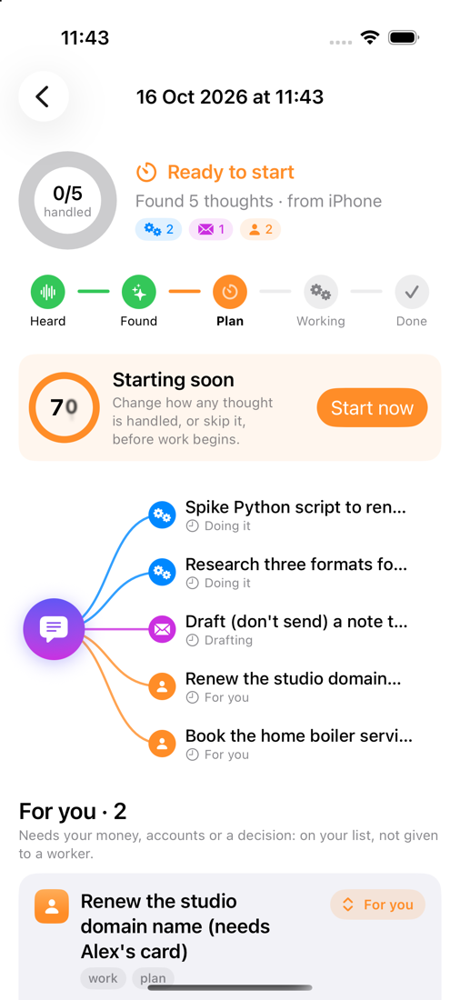
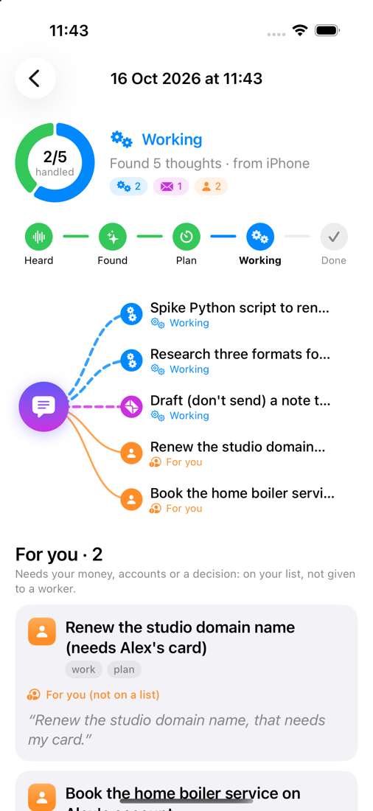
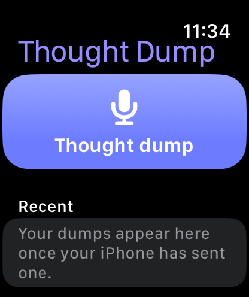
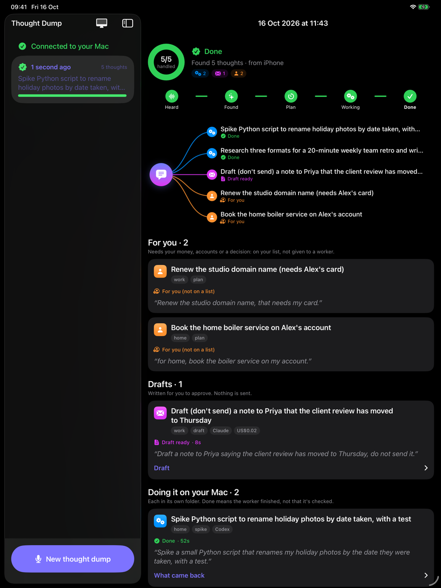

<p align="center"></p>

# Thought Dump

**Say what's on your mind. Your Mac turns it into a team of Claude Code agents.**

Tap the button on your iPhone, iPad or Apple Watch and talk through everything you need to do.
Your Mac finds the separate thoughts in what you said and decides how to handle each one:

- **Local work** (spikes, fixes, research, plans) runs as background Claude Code or Codex agents, each in its own sandboxed folder.
- **Anything involving other people** (emails, posts, messages) becomes a draft. Nothing is ever sent.
- **Anything needing your money, accounts or a decision** goes on your to-do list instead of to an agent.

The app shows it all as it happens: which thoughts were found, how each is being handled, which agents are working, and what came back.

<p align="center">
  
  
  
</p>
<p align="center">
  
</p>

## How it works

```text
iPhone / iPad / Watch                     Your Mac
─────────────────────                     ────────
record ─► on-device transcription ─HTTPS─► server.py (token, tailnet)
          (audio never leaves the phone)      │
                                               ▼
                                          dump capture
                                            ├─ split:  claude -p --json-schema → tasks.json
                                            ├─ plan:   30-second countdown (change a route, skip, start now)
                                            ├─ to-dos: your list (optional adapter) or "for you" in the app
                                            ├─ drafts: tool-free Claude worker, nothing sent
                                            └─ work:   Codex (spikes, fixes) / Claude (the rest), quota-capped
                                               │
app ◄─────────── live snapshot (1.5 s polling) ┘   + optional notification with a link
```

Each thought gets a **route**:

| Route | When | What happens |
| --- | --- | --- |
| For you | needs your money, a purchase, signing in to your accounts, or a decision only you can make | On your to-do list (if you configure one), otherwise shown in the app as "for you" |
| Draft | involves another person: sending, posting, publishing, paying | A worker with no tools writes the draft; you copy what you approve |
| Run | everything else | A worker does it in its own folder: Codex for spikes and fixes, Claude for the rest |
| Skip | you said so | Nothing |

During the countdown you can change any route from the app.

## Safety

- **Nothing is sent, published, pushed or paid for.** Outward items become drafts. Every worker brief says so and treats the task text as untrusted.
- **Claude workers** run `claude -p` in restricted and safe mode, with no MCP servers, hooks, browser or skills. Local workers get only Read, Write, Edit, Glob and Grep, confined to their own folder. Splitter and draft workers get no tools.
- **Codex workers** run `codex exec --ignore-user-config --sandbox workspace-write` in a git-initialised folder: they can run what they build, offline, and only there.
- **Guard rails:** at most 4 workers (lower if your quota command says so), 45 minutes each, with the whole process group killed on timeout or Stop.
- **The API** binds 127.0.0.1. Put it on your tailnet with `tailscale serve` (never Funnel). Every route needs a bearer token, and it can also require your Tailscale login.
- **The phone transcribes on-device.** Only the text goes to your Mac, and from there to Claude to be split.

## Set it up

You need macOS with Python 3.10+ (standard library only), [Claude Code](https://code.claude.com) signed in, optionally the [Codex CLI](https://github.com/openai/codex), Xcode 27, [XcodeGen](https://github.com/yonaskolb/XcodeGen), and [Tailscale](https://tailscale.com) on the Mac and the phone.

```bash
git clone https://github.com/jhammant/thought-dump && cd thought-dump
python3 -m unittest discover -s tests          # 48 tests, no model calls
python3 scripts/demo.py --state-dir .demo/try  # offline demo with a stub model
```

1. **Configure** `~/.thought-dump/config.json`. Everything is optional; these are the defaults plus examples:

   ```json
   {
     "owner": "Alex",
     "workspaces": {"work": "my job at the studio", "home": "home, family, health, my own money"},
     "hold_seconds": 30,
     "notify": ["/usr/local/bin/my-notify"],
     "quota": ["node", "/path/to/quotamax/src/cli.mjs", "agent"],
     "todo": {"adapter": "command", "argv": ["/path/to/add-todo"], "workspaces": ["work"]},
     "pages_url": "",
     "server": {"port": 8783, "allowed_logins": ["you@example.com"]}
   }
   ```

   - `notify` gets one line appended (counts and a link, never what you said).
   - `quota` should print JSON shaped like `{"ok": true, "headroom": "ample", "advice": {"parallelism": 3}}`.
   - A `command` to-do adapter receives the task as JSON on stdin and prints `{"id": "..."}`.

2. **Run the API** and put it on your tailnet:

   ```bash
   ./dump pair --url https://your-mac.your-tailnet.ts.net:8783   # makes the token, prints a pairing link
   ./dump serve                                                  # keep it running (launchd, or your supervisor)
   tailscale serve --bg --https=8783 http://127.0.0.1:8783
   ```

3. **Build the app.** In `app/project.yml`, set your `DEVELOPMENT_TEAM` and bundle ID prefix, then:

   ```bash
   cd app && xcodegen generate && open ThoughtDump.xcodeproj
   ```

   Run it on your iPhone. To pair, type your Mac's tailnet address: if `allowed_logins` includes your Tailscale login, the Mac hands over the token. Or open the `thoughtdump://pair?...` link that `dump pair` printed. `app/scripts/testflight.sh` archives and uploads to TestFlight with an App Store Connect API key.

## Without the app

```bash
./dump capture note.md --state-dir ~/.thought-dump/batches/today   # split, countdown, run, report
./dump ingest  "Spike a CSV parser. Draft a note to Sam." --state-dir b   # split only
./dump go      --state-dir b --hold 0                                     # route and run
./dump report  --state-dir b                                              # static HTML page
```

Any capture path works: a Shortcut, a Voice Memos watcher, an email rule. They only have to call `dump capture` or `POST /api/dumps`.

## API

| Method | Path | |
| --- | --- | --- |
| GET | `/api/pair` | Token for an allowed Tailscale login (no token needed) |
| GET | `/api/health` | |
| GET | `/api/dumps` | Newest first, summaries |
| POST | `/api/dumps` | `{"text", "client_id", "recorded_at"?, "duration_seconds"?, "device"?}`, idempotent by `client_id` |
| GET | `/api/dumps/<id>` | The note, its thoughts, routes, statuses, outputs and files |
| POST | `/api/dumps/<id>/plan` | `{"start_now"?, "routes"?: {task: run\|draft\|todo\|skip}, "stop"?: [task]}` |
| POST | `/api/dumps/<id>/retry` | Split again after a failed split |
| GET | `/api/dumps/<id>/files/<task>/<path>` | A file a worker made |

## Build your own

[`docs/build-prompt.md`](docs/build-prompt.md) is a prompt you can hand to Claude Code to build this from scratch, your way.

## Licence

MIT
